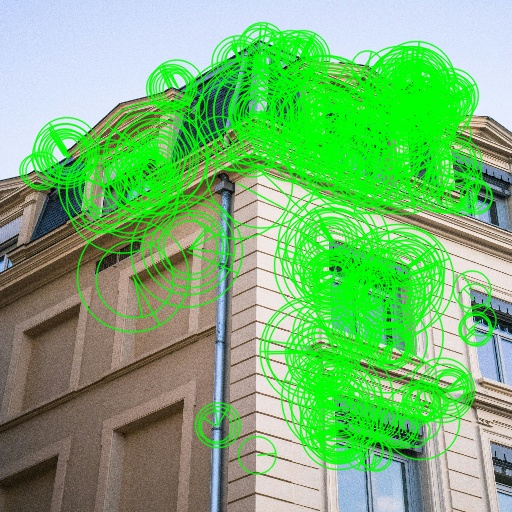

# Köşe Tespiti Algoritmalarının Karşılaştırılması

Bu proje, **bilgisayarla görme (Computer Vision)** alanında kullanılan **Harris**, **Shi-Tomasi**, **FAST** ve **ORB** algoritmalarını farklı görüntüler üzerinde uygulamak ve sonuçlarını karşılaştırmak amacıyla hazırlanmıştır.

Proje kapsamında görüntüler ön işleme aşamasından geçirilir, tespit edilen köşe veya anahtar noktalar görüntüler üzerinde işaretlenir ve algoritmaların tespit sayıları ile çalışma süreleri kaydedilir.

> **Kapsam notu:** Derin öğrenme tabanlı yaklaşımlar proje raporunda incelenmiştir; paylaşılan Python kodlarında bir derin öğrenme modeli uygulaması bulunmamaktadır.
> ## Örnek Sonuç Görselleri

Aşağıda aynı bina görüntüsünün dört farklı algoritma ile işlenmiş örnek sonuçları yer almaktadır.

<table>
  <tr>
    <td align="center">
      <b>Harris</b><br>
      
    </td>
    <td align="center">
      <b>Shi-Tomasi</b><br>
      
    </td>
  </tr>
  <tr>
    <td align="center">
      <b>FAST</b><br>
      
    </td>
    <td align="center">
      <b>ORB</b><br>
      
    </td>
  </tr>
</table>

Bu görseller, aynı sahnede farklı köşe / anahtar nokta tespit algoritmalarının ürettiği sonuçları görsel olarak karşılaştırmak amacıyla eklenmiştir.

## Kullanılan teknolojiler

- **Python:** Uygulama dili
- **OpenCV:** Görüntü işleme ve köşe/anahtar nokta tespiti
- **NumPy:** Sayısal işlemler
- **pandas:** Performans sonuçlarının tablo halinde oluşturulması

## Kullanılan algoritmalar

| Algoritma | Temel yaklaşım |
|---|---|
| **Harris** | Görüntü gradyanlarından elde edilen köşe yanıtını kullanır. |
| **Shi-Tomasi** | İzlemeye elverişli güçlü köşeleri seçer. |
| **FAST** | Piksellerin çevresindeki yoğunluk farklarına göre hızlı anahtar nokta tespiti yapar. |
| **ORB** | FAST tabanlı anahtar nokta tespitini ve BRIEF tabanlı tanımlayıcıları birleştirir. |

## Veri seti

Deneylerde dört görüntü kategorisi kullanılmıştır:

- **building:** Bina görüntüleri
- **road:** Yol görüntüleri
- **indoor:** İç mekân görüntüleri
- **texture:** Dokulu yüzey görüntüleri

`preprocess.py`, `dataset/` altındaki görselleri gri seviyeye dönüştürür, **512 × 512** boyutuna getirir ve `processed/grayscale/` altına kaydeder.

## Klasör ve dosya yapısı

```text
corner_detection_project/
├── dataset/                  # Orijinal görseller
│   ├── building/
│   ├── road/
│   ├── indoor/
│   └── texture/
├── processed/
│   └── grayscale/            # Ön işlenmiş görseller
├── demo/                     # Algoritmalara göre işaretlenmiş görseller
├── results/                  # Sonuç görselleri ve ek ölçümler
├── report_images/            # Rapor için seçilmiş görseller
├── preprocess.py             # Görüntülerin ön işlenmesi
├── harris_corner.py          # Harris uygulaması
├── shi_tomasi.py             # Shi-Tomasi uygulaması
├── fast.py                   # FAST uygulaması
├── orb.py                    # ORB uygulaması
├── all_metrics.py            # Toplu performans ölçümü
├── all_metrics_results.csv   # Görüntü bazında ölçümler
├── all_metrics_summary.csv   # Ortalama sonuçlar
├── requirements.txt          # Python bağımlılıkları
├── .gitignore                # Git dışında bırakılan yerel dosyalar
└── README.md                 # Proje açıklaması
```

## Kurulum

Bilgisayarda Python 3 ve Git yüklü olmalıdır. Aşağıdaki komutlar proje ana klasöründe **Windows PowerShell** ile çalıştırılabilir:

```powershell
py -m venv .venv
.\.venv\Scripts\python.exe -m pip install -r requirements.txt
```

Bu yöntem sanal ortamı etkinleştirmeyi gerektirmez.

## Projeyi çalıştırma

Proje ana klasöründeyken komutları sırasıyla çalıştırın:

```powershell
.\.venv\Scripts\python.exe preprocess.py
.\.venv\Scripts\python.exe harris_corner.py
.\.venv\Scripts\python.exe shi_tomasi.py
.\.venv\Scripts\python.exe fast.py
.\.venv\Scripts\python.exe orb.py
.\.venv\Scripts\python.exe all_metrics.py
```

Bu işlemler sonucunda:

1. **`processed/grayscale/`** altında gri seviyeli görüntüler oluşturulur.
2. **`demo/`** altındaki algoritma klasörlerine işaretlenmiş görüntüler kaydedilir.
3. **`orb.py`**, özgün `dataset/` klasörünü kullanarak `results/orb_metrics.csv` dosyasını oluşturur.
4. **`all_metrics.py`**, `all_metrics_results.csv` ve `all_metrics_summary.csv` dosyalarını ana klasöre yazar.

**Not:** Dosyalar göreli klasör yolları kullandığından komutların proje ana klasöründe çalıştırılması önemlidir.

## Kaydedilmiş performans sonuçları

Projeyle birlikte gelen `all_metrics_summary.csv` dosyasında yer alan ortalama ölçümler:

| Algoritma | Ortalama tespit sayısı | Ortalama süre (ms) |
|---|---:|---:|
| FAST | 7413,10 | 3,262 |
| Harris | 18499,75 | 124,975 |
| ORB | 483,90 | 20,763 |
| Shi-Tomasi | 100,00 | 113,997 |

Bu deneyde **FAST**, kaydedilmiş ortalama işlem süresi bakımından en hızlı algoritmadır. Ancak ölçülen süreler donanıma ve çalışma koşullarına göre değişebilir.

**Önemli:** Tespit sayıları doğrudan bir **doğruluk (accuracy)** ölçüsü değildir. Harris için eşik üstündeki yanıt pikselleri sayılırken Shi-Tomasi en fazla 100, ORB ise hedef olarak 500 anahtar nokta döndürmeye ayarlanmıştır. FAST, tespit ettiği anahtar noktaları sayar. Bu nedenle sayılar birbirleriyle doğrudan doğruluk karşılaştırması için kullanılmamalıdır.

## Sınırlılıklar

- Projede etiketlenmiş gerçek köşe noktalarına dayalı bir doğruluk testi bulunmaz.
- Gürültüye dayanıklılık, kodlardaki toplu ölçümde ayrı bir sayısal metrik olarak hesaplanmaz.
- Derin öğrenme yöntemleri literatür kapsamında ele alınmış, sağlanan kodlarda uygulanmamıştır.
- Görsellerin kaynak ve yeniden kullanım izinleri doğrulanmadan üçüncü taraf veri setleri açık depoda paylaşılmamalıdır.

## Akademik rapor

Projeyle ilişkili IEEE biçimindeki çalışma: **“Köşe Tespiti Algoritmalarının Karşılaştırılması: Harris, Shi-Tomasi, FAST ve Derin Öğrenme Yaklaşımları”**.

Bu çalışma eğitim ve araştırma amaçlı bir bilgisayarla görme projesidir.

[IEEE Formatındaki Proje Raporunu Görüntüle](docs/Kose_Tespiti_Proje_Raporu.pdf)

## Veri Seti ve Yeniden Üretilebilirlik

Projenin orijinal deneylerinde bina, iç mekan, yol ve doku kategorilerinden toplam 20 görüntü kullanılmıştır.

Kaynak ve yeniden paylaşım izinleri doğrulanamayan 5 doku görüntüsü ile bunlardan üretilen görseller, herkese açık depoya dahil edilmemiştir.

Depoda 15 kaynak görüntü bulunmaktadır. Mevcut performans CSV dosyaları orijinal 20 görüntülük deneyin sonuçlarını içermektedir. Yalnızca paylaşılan görüntülerle yeniden çalıştırılan deneylerde farklı sonuçlar elde edilebilir.
